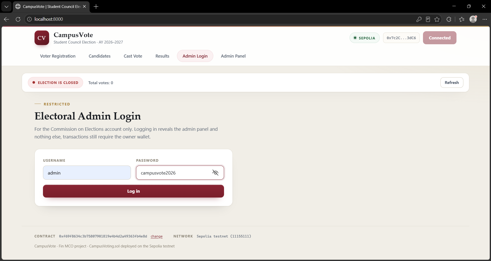
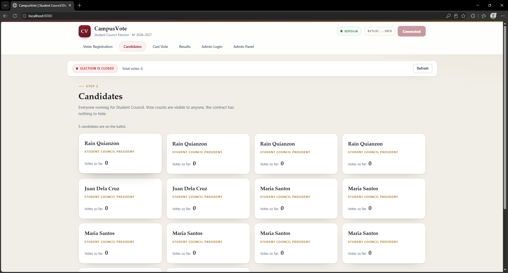
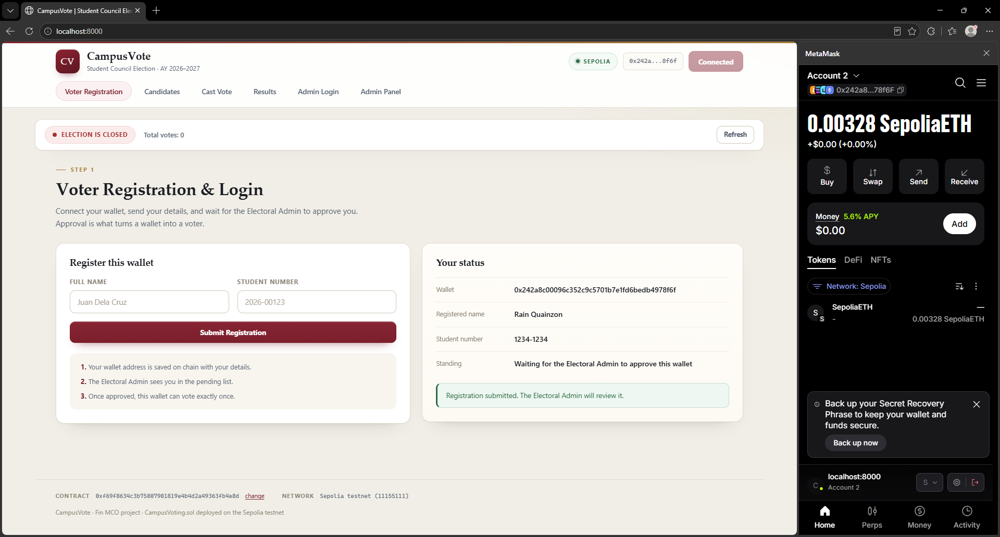
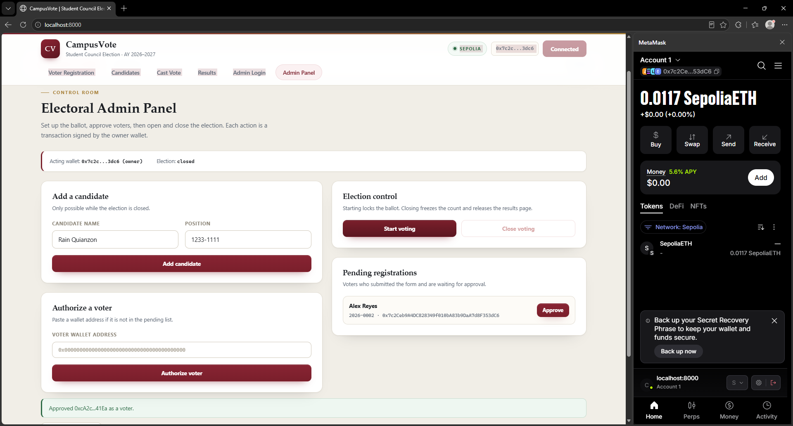
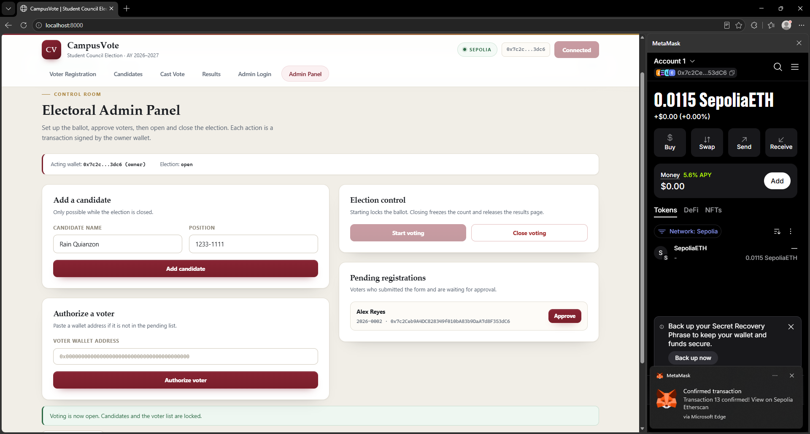
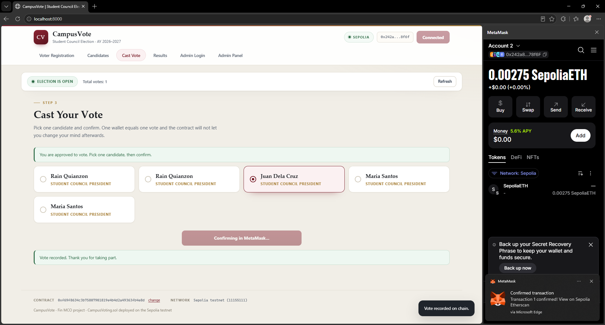
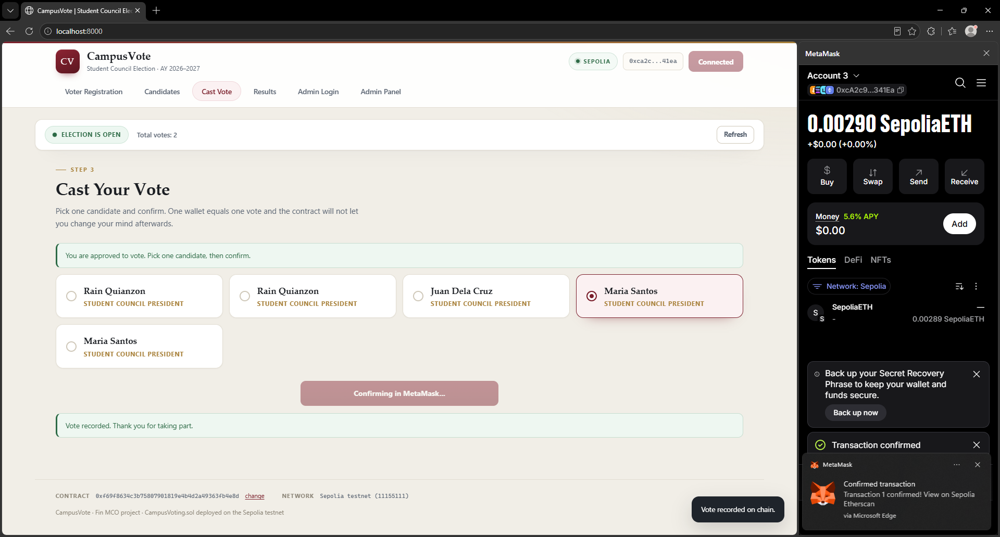
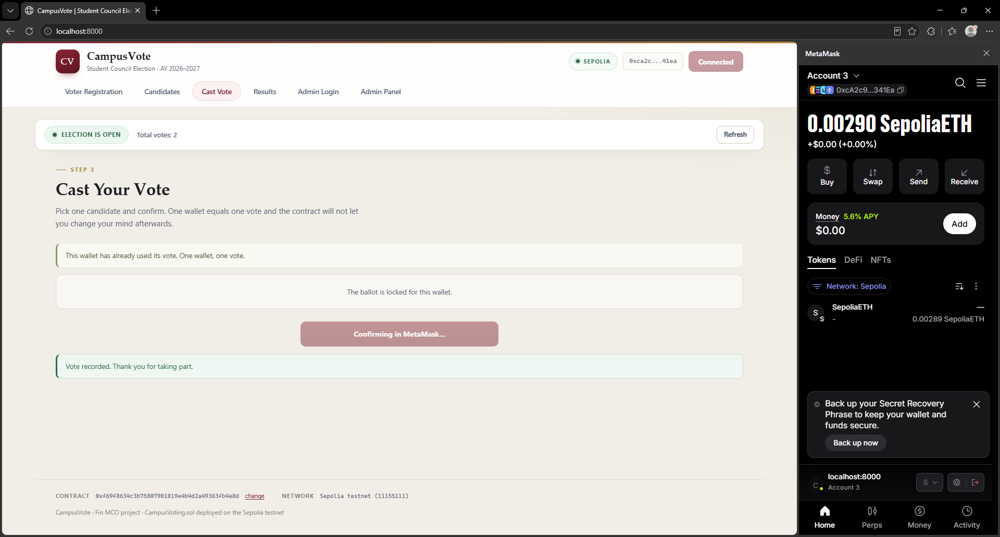
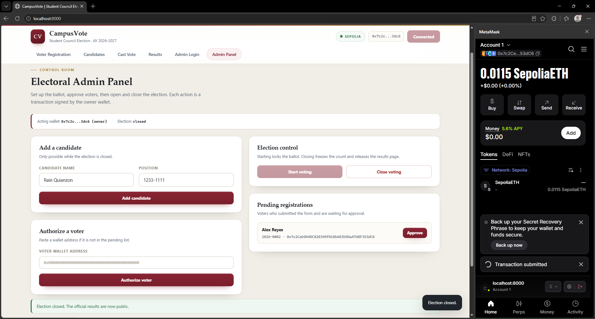
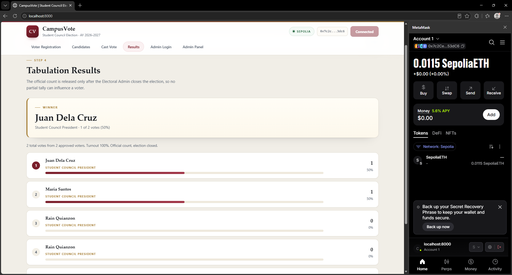

# CampusVote — Student Council Voting dApp

A blockchain voting system for the student council election. Every vote is a real
transaction on the Sepolia testnet, so the tally is public and nobody can change a
vote after it is cast.

Built for the Fin MCO requirement: The Voting dApp.

---

## Group members


| Name | Role |
| --- | --- |
| Quianzon, Rain | Group leader |
| Quizon, FR | Member |
| Biteng, Guianne Marie B. | Member |
| Gabor, Nelly Jane | Member |


---

## What the app does

**Voter side**

- Register a wallet with a full name and student number
- Wait for the Electoral Admin to approve that wallet
- View the list of candidates
- Cast exactly one vote, and only while the election is open
- View the official results after the admin closes the election

**Admin side**

- Log in with a premade Commission on Elections account
- Add candidates
- Approve or authorize voter wallets
- Start the voting process
- Close the voting process and release the results

---

## Screenshots

### 1. Electoral Admin login



### 2. Adding candidates



### 3. Voter registration



### 4. Authorizing a voter



### 5. Starting the voting process



### 6. Account 2 casts a vote



### 7. Account 3 casts a vote



### 8. A second vote from the same wallet is blocked



### 9. Closing the election



### 10. Tabulation results



---

## How the pieces connect

- **The smart contract** (`contracts/CampusVoting.sol`) is the source of truth. It
  stores the candidates, the approved voter list, who has already voted, and the
  vote counts. Its functions are open for anyone to read but only the owner wallet
  can add candidates, approve voters, and open or close the election.
- **The HTML** (`frontend/index.html`) holds all six screens in one page: voter
  registration, candidates, cast vote, results, admin login, and the admin panel.
  Only one screen is visible at a time, so switching tabs never drops the wallet
  connection.
- **The CSS** (`frontend/style.css`) is the whole look of the app, with no
  framework. All colours and sizes are declared once at the top so the page stays
  consistent.
- **The JavaScript** (`frontend/app.js`) is the glue. Ethers.js uses the ABI to
  know which contract functions exist, MetaMask signs each transaction, and the
  script reads the replies back to update the screen.
- **The ABI** (`frontend/abi.json`) is the contract's public interface. It is the
  file that lets the browser talk to the deployed contract.

---

## Tech stack

| Component | Tool |
| --- | --- |
| Smart contract language | Solidity 0.8.24 |
| Access control | OpenZeppelin `Ownable` 5.0.2 |
| Blockchain | Ethereum Sepolia testnet (chain ID 11155111) |
| Contract IDE and deployment | Remix IDE |
| Wallet | MetaMask |
| Frontend markup | HTML5 |
| Frontend styling | CSS3 |
| Frontend logic | JavaScript |
| Blockchain library | Ethers.js 5.7.2 (CDN) |
| Version control | Git and GitHub |

---

## Deployed contract

| Item | Value |
| --- | --- |
| Network | Sepolia testnet |
| Contract address | `0x0000000000000000000000000000000000000000` |

Replace the address above with your own deployed address. It is the same address
you paste into the app the first time you open it.

To redeploy: open Remix, paste `contracts/CampusVoting.sol`, compile with version
0.8.24, connect MetaMask on Sepolia with the admin wallet, and press Deploy.

---

## Project structure

```
voting-dapp/
├── index.html              Single file build of the whole app
├── contracts/
│   └── CampusVoting.sol    The smart contract
├── frontend/
│   ├── index.html          The app, markup only
│   ├── style.css           The app, styling only
│   ├── app.js              The app, logic and contract calls
│   └── abi.json            Contract ABI copied from Remix
└── screen_shot/            Screenshots of the full run
```

There are two ways to open the app, and both run the same system.

- `index.html` in the root folder has the CSS and the JavaScript already pasted
  inside it. Double click it and the app is running.
- `frontend/index.html` is the same app kept as separate files, which is the
  layout the project guide asks for.

---

## Running it

1. Install MetaMask in Chrome, Edge, or Brave, and switch it to the Sepolia
   network.
2. Prepare three accounts with a little Sepolia ETH in each. One is the admin,
   the other two are voters.
3. Deploy `contracts/CampusVoting.sol` in Remix using the admin account, then copy
   the deployed contract address.
4. Open `index.html`. The first time, a box at the top asks for that address.
   Paste it and press Save. The browser remembers it.
5. Press **Connect Wallet** and approve the MetaMask prompt.

If you prefer to run the split version, open the `frontend` folder in VS Code,
start Live Server on `frontend/index.html`, and paste the contract address into
`contractAddress` near the top of `app.js` instead of using the box on the page.

### Admin account

```
username: admin
password: campusvote2026
```

Logging in only reveals the admin panel. The actual transactions still have to be
signed by the wallet that deployed the contract.

---

## The voting rules

These are enforced by the contract, not by the page. Editing the page in the
browser does not get around any of them.

- One election per deployed contract
- Only the owner can add candidates and approve voters
- Only approved wallets can vote
- Each approved wallet can vote exactly once
- Voting only works while the election is open
- Anyone can read the candidate names and the vote counts
- Only the owner can close the election, and closing freezes the count

The results page stays sealed while voting is open so nobody can see a partial
tally. It releases the full ranking once the admin closes the election.

---

## Demo order

1. Admin logs in and adds the candidates
2. Voter accounts submit the registration form
3. Admin approves each voter
4. Admin presses Start voting
5. Each voter casts one vote
6. A second attempt from the same wallet fails
7. Admin presses Close voting
8. Results tab shows the winner and the full ranking
